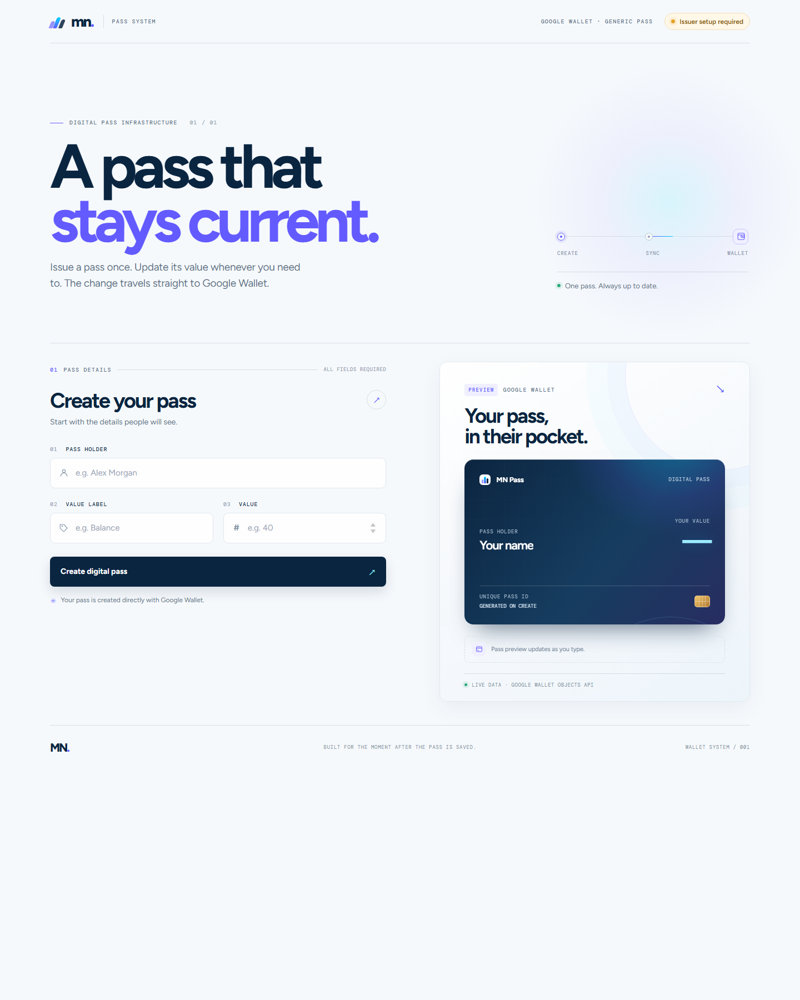
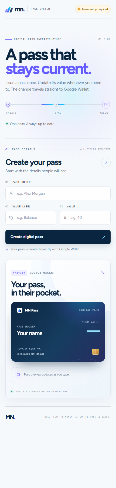

# MN Pass

Issue a Google Wallet pass once, then change the value on the same saved pass through an API. MN Pass pairs a focused pass-building interface with a small TypeScript service that treats Google Wallet as the source of truth.

## Product preview

The desktop and mobile screenshots below are the real app interface. The preview card is intentionally illustrative until Google Wallet issuer credentials are configured; this repository does not use fake passes or pretend a Wallet operation succeeded.

<p align="center">
  
</p>

<p align="center">
  
</p>

## What it does

- Create a Google Wallet Generic pass with a holder name, a custom value label, and a numeric value.
- Create or reuse the configured Generic class, then create a unique Google Wallet object for each pass.
- Generate an **Add to Google Wallet** link signed by the service account and a QR code containing the unique pass ID.
- Preview the pass as the form is filled in, with clear issuer configuration status and actionable API errors.
- Update the saved object in place with `POST /passes/{id}`. The existing pass receives the changed value; the user does not need to add a replacement pass.
- Read the current object from Google Wallet with `GET /api/passes/{id}`.
- Show a ready-to-copy cURL update request after pass creation.
- Keep provider-neutral pass types, business logic, and an `IWalletProvider` interface separate from Google-specific API calls so another wallet provider can be added behind the same contract.
- Include health and configuration endpoints for deployment checks.

There is no demo-data backend or in-memory pass store. Without valid Google Wallet credentials, pass creation and updates fail with an error instead of returning a simulated success. The interface can still be previewed locally.

## Stack

- Node.js 20+
- TypeScript and Express
- Google Auth Library and Google Wallet Objects REST API
- Google Wallet Save JWT signed with the service-account private key
- QR code generation with `qrcode`
- Static HTML, CSS, and JavaScript frontend served by Express

## Requirements

- Node.js 20 or newer and npm
- A Google Wallet issuer account
- A Google Cloud project with the Google Wallet Objects API enabled
- A service account with a JSON key and access granted to the Wallet issuer
- A Google account added as a Wallet test user while the issuer is in Demo Mode

New issuers generally start in Demo Mode. A pass can only be saved by an issuer admin, developer, or test account configured in the Google Pay & Wallet Console. Add the Google account used on the Android phone before testing.

## Google Wallet setup

1. Create or select an issuer in the [Google Pay & Wallet Console](https://pay.google.com/business/console) and copy the Issuer ID.
2. In Google Cloud Console, select the associated project, enable the [Google Wallet Objects API](https://developers.google.com/wallet/generic), and create a service account.
3. In the Wallet Console, grant that service account access to the issuer. Create a JSON key for local development and keep it private.
4. Add your Android phone's Google account as a test account in the Wallet Console if the issuer is in Demo Mode.
5. Copy `.env.example` to `.env` and configure the variables below. Never commit `.env`, a service-account JSON key, or a private key.

| Variable | Required | Description |
| --- | --- | --- |
| `PORT` | No | HTTP port. Defaults to `3000`. |
| `PUBLIC_ORIGIN` | Yes for Save links | The exact public app origin, such as `https://mn.example.com`, with no path. It must match the app's actual origin. |
| `GOOGLE_WALLET_ISSUER_ID` | Yes | Issuer ID from the Wallet Console. |
| `GOOGLE_WALLET_CLASS_ID` | No | Class suffix created/reused by the app. Defaults to `general_pass_class`. |
| `GOOGLE_APPLICATION_CREDENTIALS` | One credential option | Path to the service-account JSON file. Defaults to `./service_account.json` when set in `.env.example`. |
| `GOOGLE_CLIENT_EMAIL` | Alternative credential option | Service-account email, when configuring credentials directly. |
| `GOOGLE_PRIVATE_KEY` | Alternative credential option | Service-account PEM key. In `.env`, newlines may be written as `\n`. Keep this secret. |

Use either the JSON key file or both `GOOGLE_CLIENT_EMAIL` and `GOOGLE_PRIVATE_KEY`. For production, configure secrets in the hosting provider instead of uploading a key file.

## Run locally

```bash
npm ci
cp .env.example .env
# Edit .env and add your Wallet issuer and service-account configuration.
npm run dev
```

Open [http://localhost:3000](http://localhost:3000). On Windows PowerShell, use `Copy-Item .env.example .env` in place of `cp`.

To build and run the production bundle:

```bash
npm run build
npm start
```

The build compiles TypeScript into `dist/` and copies the static frontend to `dist/public/`. The service reads `PORT` from the environment, which allows a Node.js host to supply its assigned port.

## API

All request and response bodies are JSON. Pass IDs are generated by the server and have the form `pass_<random id>`.

### Create a pass

```http
POST /api/passes
Content-Type: application/json

{"name":"Alex Morgan","label":"Balance","value":40}
```

Example using cURL:

```bash
curl -X POST http://localhost:3000/api/passes \
  -H "Content-Type: application/json" \
  -d '{"name":"Alex Morgan","label":"Balance","value":40}'
```

On success, the service returns `201` with `data.id`, `data.saveUrl`, `data.qrCodeDataUrl`, and the created pass fields. Open `saveUrl` on an eligible Android phone to add that object to Google Wallet. The QR code encodes the pass ID for identification; it is not a substitute for the signed Save link.

### Update a saved pass

```http
POST /passes/{id}
Content-Type: application/json

{"value":55}
```

Example:

```bash
curl -X POST http://localhost:3000/passes/pass_0123456789abcdef01234567 \
  -H "Content-Type: application/json" \
  -d '{"value":55}'
```

`POST /api/passes/{id}` is also available. You can optionally change the label at the same time with `{"value":55,"label":"Points"}`. The API reads the existing Wallet object, patches that object, and returns the old and new values. Google Wallet handles refreshing the already-saved pass on the phone; the device must be online and Wallet may take a short time to sync.

### Read a pass

```http
GET /api/passes/{id}
```

The response is read from Google Wallet, not a local cache. An unknown pass returns `404`.

### Service status

```http
GET /api/status
GET /api/health
```

`/api/status` reports whether issuer credentials are configured and lists the primary routes. `/api/health` returns a lightweight process health response suitable for a host health check; it does not claim that Google credentials or the Wallet API are available.

### Errors

Invalid form/API input returns `400`. A missing Wallet object returns `404`. Google Wallet or authentication failures return an error response; a `200` update response means Google accepted the object patch, not that a particular device has already refreshed its screen.

## Architecture

```text
Browser UI ──HTTP──> Express routes ──> PassController ──> PassService
                                                        │
                                                        └──> IWalletProvider
                                                              └── GoogleWalletProvider
                                                                  └── Wallet Objects API
```

The controller validates HTTP input and formats responses. The service owns provider selection and pass use cases. `IWalletProvider` and the provider-neutral types define the extension seam; `GoogleWalletProvider` handles class/object creation, signed Save links, QR codes, and object reads/patches. Google Wallet is the canonical store, so an app restart does not lose pass state.

```text
src/
  controllers/       HTTP validation and response handling
  core/              Provider-neutral pass types
  providers/          Wallet-provider contract and implementations
    google-wallet/    Google Wallet API integration
  services/           Provider selection and pass use cases
  public/             Responsive browser UI
docs/screenshots/     README product screenshots
```

## Deployment

Deploy the repository to a Node.js host that supports a long-running web service (for example, Render). Configure the Wallet secrets in the host's environment settings, set `PUBLIC_ORIGIN` to the deployed HTTPS origin, and use `npm ci`, `npm run build`, and `npm start` as install/build/start commands. Set the host health-check path to `/api/health` if supported.

After deployment, check `/api/health` and `/api/status`, create a pass with an authorized test account, open its Save link on an Android phone, then call the update endpoint and wait for Wallet to sync. Do not expose service-account credentials in build logs, frontend code, screenshots, or this repository.

## Scripts

| Command | Purpose |
| --- | --- |
| `npm run dev` | Run the TypeScript server with file watching. |
| `npm run build` | Type-check/compile the server and copy frontend assets. |
| `npm start` | Run the compiled production server. |

## License

MIT. See [LICENSE](LICENSE).
